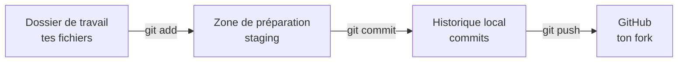

# Git : enregistrer ton travail

Git garde l'historique de ton code. Chaque **commit** est une photo de tes fichiers à un instant, avec un message qui explique ce qui a changé.

## Les trois zones de Git

1. **Le dossier de travail** : les fichiers tels que tu les modifies.
2. **La zone de préparation** (staging) : ce que tu as choisi de mettre dans le prochain commit, avec `git add`.
3. **L'historique** : les commits, créés avec `git commit`. Ils restent sur ton Codespace jusqu'au `git push`.

## Les commandes du quotidien

| Commande | Ce qu'elle fait |
| --- | --- |
| `git status` | Montre ce qui a changé et ce qui est préparé. Lance-la tout le temps |
| `git diff` | Montre les lignes modifiées, pas encore préparées |
| `git add fichier` | Prépare un fichier pour le prochain commit |
| `git commit -m "message"` | Crée le commit avec ce qui est préparé |
| `git log --oneline` | Liste les commits |
| `git push` | Envoie tes commits sur GitHub |

## Écrire un bon message de commit

Un bon message dit **ce que fait** le commit, au présent, en une ligne courte :

- Bien : `Ajoute le script d'ingestion des zones`
- Pas bien : `update`, `modifs`, `ça marche enfin`

En entreprise, beaucoup d'équipes utilisent un préfixe : `feat:` (nouvelle fonctionnalité), `fix:` (correction), `docs:` (documentation). Par exemple : `feat: ingestion des zones de taxi`.

## Ce qu'on ne commite jamais

- Les secrets : mots de passe, clés de compte de service (`*.json` de Google Cloud), fichiers `.env`.
- Les fichiers générés ou lourds : données (`*.csv`, `*.parquet`), environnements virtuels (`.venv/`), états Terraform (`*.tfstate`).

On les liste dans un fichier `.gitignore` : Git fait alors comme s'ils n'existaient pas.

## Qui es-tu pour Git ?

Dans un Codespace, ton nom et ton e-mail GitHub sont déjà configurés. Vérifie avec `git config user.name` et `git config user.email`.

@@ predict
Tu modifies `README.md`, puis tu lances `git add README.md`. Ensuite, tu modifies **encore** `README.md`, et tu lances `git commit -m "..."`. Quelle version du fichier est enregistrée dans le commit ?

@@ predict-answer
La version **du moment du `git add`**. La deuxième modification n'est pas préparée : elle reste dans ton dossier de travail. `git status` montre alors le même fichier deux fois, une fois en « Changes to be committed » et une fois en « Changes not staged ». C'est la preuve que la zone de préparation est une vraie photo, pas un simple marque-page.

@@ practice
Enregistre ton espace de travail dans l'historique de ton fork, proprement.

@@ constraints
- `mon-travail/README.md` contient ton contrat d'apprentissage de la leçon 1, sous le titre
- Un fichier `mon-travail/.gitignore` ignore au minimum : `.venv/`, les fichiers `.parquet`, les fichiers `.csv.gz`, les fichiers `.env` et un dossier `keys/`
- **Deux commits séparés** : un pour le README, un pour le `.gitignore`, chacun avec un message clair
- Les deux commits sont poussés sur GitHub, et visibles dans ton fork

@@ hints
- Pour faire deux commits séparés, ne fais pas `git add .` : prépare un seul fichier à la fois, et vérifie avec `git status` avant chaque commit.
- Dans un `.gitignore`, une ligne = une règle. `*.parquet` ignore tous les fichiers qui finissent par `.parquet`, et `keys/` ignore un dossier.
- Ta branche s'appelle `main`. Pour pousser : `git push`. Si Git te demande une « upstream branch », lis bien le message : il te donne la commande exacte.

@@ solution
~~~bash
cd /workspaces/data-engineering-zoomcamp
# écrire le contrat dans mon-travail/README.md avec l'éditeur, puis :
git add mon-travail/README.md
git commit -m "docs: mon contrat d'apprentissage"

cat > mon-travail/.gitignore <<'FIN'
.venv/
*.parquet
*.csv.gz
.env
keys/
FIN
git add mon-travail/.gitignore
git commit -m "chore: ignorer les fichiers lourds et les secrets"

git log --oneline -3
git push
~~~

@@ verify
gitignore

@@ selfcheck
- `git log --oneline -3` montre mes deux commits
- Sur la page GitHub de mon fork, le dossier `mon-travail` apparaît avec les deux fichiers

@@ breakfix
Crée `mon-travail/secret.env` avec la ligne `PASSWORD=test`. Force-le dans un commit avec `git add -f mon-travail/secret.env` puis `git commit -m "oups"`, **sans pousser**. Un secret est maintenant dans ton historique. Retire-le du dernier commit sans supprimer le fichier de ton disque.

@@ breakfix-hints
- Il existe une option de `git rm` qui retire un fichier de Git sans le supprimer du disque.
- Un commit qui n'a pas encore été poussé peut être modifié : regarde l'option `--amend` de `git commit`.
- Vérifie le résultat avec `git show --stat HEAD` : le fichier ne doit plus apparaître dans le commit.

@@ breakfix-answer
~~~bash
git rm --cached mon-travail/secret.env
git commit --amend -m "..."     # ou annuler le commit avec : git reset HEAD~1
git show --stat HEAD
~~~
Ici, ton `.gitignore` ignorait déjà les `.env` : c'est le `-f` qui l'a forcé, et c'est pour ça que la règle existe. **Si un secret a déjà été poussé**, le retirer de Git ne suffit pas : il faut considérer qu'il est public et le changer (nouveau mot de passe, nouvelle clé).

@@ explain
Explique la différence entre `git add`, `git commit` et `git push`, comme si tu l'expliquais à un camarade de ta promo.
