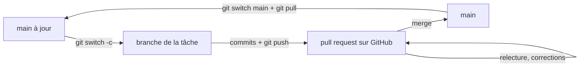

# Branches et pull requests

En équipe, personne ne travaille directement sur `main`. Chaque tâche se fait sur sa propre **branche**, puis entre dans `main` par une **pull request** (PR) : une demande de fusion que les collègues relisent avant de l'accepter. C'est ce que tu feras pendant ton PFE et dans ton futur travail.

## Le cycle d'une tâche



| Étape | Commande ou action |
| --- | --- |
| Partir de `main` à jour | `git switch main` puis `git pull` |
| Créer la branche | `git switch -c module-01/ingestion-zones` |
| Travailler | `git add`, `git commit` autant que nécessaire |
| Publier la branche | `git push -u origin module-01/ingestion-zones` |
| Ouvrir la PR | Sur GitHub, bouton **Compare & pull request** |
| Après la fusion | `git switch main`, `git pull`, puis supprimer la branche : `git branch -d …` |

## Le piège des forks

Ton repo est un **fork** du repo officiel. Quand tu ouvres une PR, GitHub propose par défaut de l'envoyer **au repo officiel de DataTalksClub**. Ce n'est pas ce que tu veux.

Sur la page de création de la PR, regarde la ligne du haut :

- **base repository** doit être `gitabdelhub/data-engineering-zoomcamp`, branche `main` ;
- **head repository** : ton fork, ta branche.

Si tu vois `DataTalksClub/data-engineering-zoomcamp` dans « base », change-le avant de cliquer.

## Une bonne pull request

- **Un titre clair**, comme un message de commit : ce que la PR apporte.
- **Une description** : ce que tu as fait, pourquoi, comment le tester.
- **Petite** : une PR qui fait une seule chose se relit en 5 minutes. Une PR énorme ne se relit jamais vraiment.

## Les conflits

Un **conflit** arrive quand deux branches modifient les mêmes lignes. Git ne peut pas choisir à ta place : il marque la zone dans le fichier.

```text
<<<<<<< HEAD
la version de ta branche actuelle
=======
la version de l'autre branche
>>>>>>> autre-branche
```

Pour résoudre : tu modifies le fichier pour garder la bonne version (ou un mélange), tu supprimes les marqueurs `<<<<<<<`, `=======`, `>>>>>>>`, puis `git add` et `git commit`. VS Code affiche aussi des boutons « Accept Current / Incoming / Both » au-dessus du conflit.

## La revue de code

Quelqu'un relit ta PR comme un collègue : commentaires sur des lignes précises, questions, demandes de changement. Tu réponds aux commentaires, tu pousses des corrections sur la même branche, et la PR se met à jour toute seule.

@@ predict
Tu es sur une branche `essai`. Tu crées un fichier `essai.txt`, tu le commites. Puis tu reviens sur `main` avec `git switch main`. Le fichier `essai.txt` est-il encore dans ton dossier ?

@@ predict-answer
**Non.** Il disparaît du dossier, parce qu'il n'existe que dans les commits de la branche `essai`. Quand tu changes de branche, Git remet ton dossier dans l'état de la branche choisie. `git switch essai` le fait réapparaître. Rien n'est perdu : c'est tout l'intérêt des branches.

@@ practice
Fais le cycle complet d'une tâche, comme en entreprise, **dans ton fork**.

@@ constraints
- Une branche nommée `module-00/presentation`, créée depuis `main` à jour
- Un fichier `mon-travail/module-00/presentation.md` : qui tu es, ton PFE, ce que tu veux savoir faire à la fin du cours
- Au moins 2 commits sur cette branche
- Une pull request **dans ton fork** (base : `gitabdelhub/data-engineering-zoomcamp`, `main`), avec une description en trois parties : Quoi, Pourquoi, Comment vérifier
- La PR est fusionnée, ton `main` local est à jour, et la branche est supprimée en local et sur GitHub

@@ guide
### 1. Pars de main à jour

Une nouvelle tâche part toujours de la dernière version de `main`. Dans le terminal, à la racine du fork :

~~~bash
git switch main
git pull
~~~

`git switch` change de branche, `git pull` récupère ce qui est arrivé sur GitHub.

### 2. Crée ta branche

`git switch -c` crée une branche et se place dessus (`-c` pour *create*). Exemple : `git switch -c module-00/essai`. Toi, ta branche s'appelle `module-00/presentation`.

Vérifie avec `git branch` : la branche marquée d'une étoile `*` est celle où tu es.

### 3. Écris ta présentation

Ouvre le fichier dans l'éditeur : `code mon-travail/module-00/presentation.md` (il est créé s'il n'existe pas). Écris pour l'instant **qui tu es**, en quelques lignes, puis enregistre avec Ctrl + S.

### 4. Premier commit

Même geste qu'à la leçon 3 : `git add` du fichier, `git status` pour vérifier qu'il est en vert, puis `git commit -m "…"` avec un message clair.

### 5. Complète, deuxième commit

Ajoute maintenant ton PFE et ce que tu veux savoir faire à la fin du cours. Enregistre, puis refais `git add` et `git commit` avec un autre message. Une branche contient souvent plusieurs commits : un par petite étape.

### 6. Envoie ta branche sur GitHub

La première fois, GitHub ne connaît pas ta branche. Il faut lui dire où l'envoyer :

~~~bash
git push -u origin module-00/presentation
~~~

`origin` est ton fork sur GitHub, et `-u` retient ce lien : les fois suivantes, un simple `git push` suffira.

### 7. Ouvre la pull request

Ouvre ton fork sur github.com. Un bandeau jaune propose **Compare & pull request** : clique dessus.

En haut de la page, **vérifie la ligne « base repository »**. Elle doit dire `gitabdelhub/data-engineering-zoomcamp`, branche `main`. Si tu vois `DataTalksClub/…`, clique dessus et choisis ton fork. Sinon ta PR partirait chez les auteurs du cours.

Donne un titre clair. Dans la description, écris trois petites parties, sur ce modèle :

~~~text
## Quoi
Ajoute ma présentation dans mon-travail/module-00.

## Pourquoi
Pour fixer mes objectifs au début du cours.

## Comment vérifier
Ouvrir mon-travail/module-00/presentation.md.
~~~

Clique sur **Create pull request**.

### 8. Fusionne

Sur la page de la PR, onglet **Files changed** : relis ce que tu proposes, comme le ferait un collègue. Puis, dans l'onglet **Conversation** : **Merge pull request**, **Confirm merge**, et enfin **Delete branch** pour supprimer la branche sur GitHub.

### 9. Remets ton Codespace à jour

Ta branche est maintenant dans `main` sur GitHub, mais pas encore dans ton Codespace :

~~~bash
git switch main
git pull
git branch -d module-00/presentation
~~~

`git branch -d` supprime la branche locale. Git accepte parce qu'elle est fusionnée : rien ne se perd.

@@ hints
- `git switch -c <nom>` crée la branche et se place dessus. Le premier `git push` d'une nouvelle branche a besoin de `-u origin <nom>`.
- Sur la page de création de la PR, vérifie la ligne « base repository » : par défaut, GitHub propose le repo de DataTalksClub.
- Après la fusion sur GitHub : reviens sur `main`, `git pull`, puis `git branch -d <nom>`. Sur GitHub, un bouton « Delete branch » apparaît juste après la fusion.

@@ solution
~~~bash
# 1. Partir de main à jour
git switch main
git pull

# 2. Créer la branche de la tâche et se placer dessus
git switch -c module-00/presentation

# 3-4. Écrire qui je suis dans l'éditeur, puis un premier commit
code mon-travail/module-00/presentation.md
git add mon-travail/module-00/presentation.md
git commit -m "docs: ma présentation"

# 5. Compléter (PFE, objectifs), puis un deuxième commit
#    -a prépare tous les fichiers déjà suivis par Git : ici, ce fichier
git commit -am "docs: ajoute mes objectifs"

# 6. Publier la branche ; -u retient le lien avec origin
git push -u origin module-00/presentation

# 7-8. Sur GitHub : Compare & pull request, base = gitabdelhub/data-engineering-zoomcamp main,
#      description Quoi / Pourquoi / Comment vérifier, puis Merge, Confirm merge, Delete branch

# 9. Remettre le Codespace à jour et supprimer la branche locale
git switch main
git pull
git branch -d module-00/presentation
~~~

@@ verify
mergedPR

@@ team
Avant de fusionner, fais relire ta pull request : envoie son lien à un camarade de ta promo, ou à Claude si tu l'as. Le relecteur laisse des commentaires sur des lignes précises dans l'onglet Files changed. Tu y réponds, et tu pousses tes corrections sur la même branche : la PR se met à jour toute seule. Pas de relecteur sous la main ? Relis-toi toi-même dans Files changed, ligne par ligne, avant de fusionner.

@@ selfcheck
- Dans l'onglet Pull requests de mon fork, ma PR est « Merged »
- `git branch` n'affiche plus `module-00/presentation`
- La PR a été ouverte dans mon fork, pas dans le repo de DataTalksClub

@@ breakfix
Provoque un **conflit** et résous-le, sans toucher à `main`. Depuis `main` à jour, crée une branche `conflit-a` : change le titre de `mon-travail/README.md` et commite. Reviens sur `main`, crée une branche `conflit-b` : change **la même ligne** autrement, et commite. Toujours sur `conflit-b`, fusionne `conflit-a`.

@@ breakfix-hints
- Pour fusionner une branche dans celle où tu es : `git merge conflit-a`. La fusion va s'arrêter sur un conflit.
- Ouvre le fichier : Git a mis les deux versions entre des marqueurs `<<<<<<<`, `=======` et `>>>>>>>`. Garde la version que tu veux et supprime les marqueurs.
- Un conflit résolu se termine comme un commit normal : `git add` du fichier, puis `git commit --no-edit`. Ensuite, reviens sur `main` et supprime les deux branches avec `git branch -D`.

@@ breakfix-answer
La fusion s'arrête avec `CONFLICT (content): Merge conflict in mon-travail/README.md`. Tu choisis la bonne version dans le fichier, tu enlèves les marqueurs, puis `git add mon-travail/README.md` et `git commit --no-edit`. Pour finir : `git switch main` puis `git branch -D conflit-a conflit-b` (`-D` force la suppression de branches qui n'ont pas été fusionnées dans `main`). En équipe, un conflit n'est pas une erreur : c'est Git qui te demande de décider, parce que deux personnes ont changé la même chose.

@@ explain
Pourquoi les équipes ne poussent-elles jamais directement sur `main` ? Donne deux raisons concrètes.

@@ resources
- [Le guide GitHub sur les pull requests](https://docs.github.com/fr/pull-requests/collaborating-with-pull-requests/proposing-changes-to-your-work-with-pull-requests/about-pull-requests)
- [Résoudre un conflit de fusion](https://docs.github.com/fr/pull-requests/collaborating-with-pull-requests/addressing-merge-conflicts/resolving-a-merge-conflict-using-the-command-line)
- [Learn Git Branching, un jeu pour s'entraîner](https://learngitbranching.js.org/?locale=fr_FR)

@@ teaser
- [01-03] Ta première issue fermée toute seule par une pull request.
