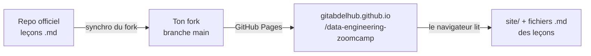

# Ton site en ligne avec GitHub Pages

Le site que tu es en train de lire est un ensemble de fichiers HTML, CSS et JavaScript rangés dans le dossier `site/` de ton fork. **GitHub Pages** les publie sur le web à chaque changement de la branche `main`.

## Comment ce site est construit

- Les leçons ne sont **pas recopiées** dans le site : le site lit directement les fichiers `.md` du cours dans ton fork. Quand le repo officiel change une leçon et que ton fork est synchronisé, le site affiche la nouvelle version.
- Mes ajouts (exercices, indices, résumés) sont dans `site/course/`. Si une leçon du cours change après que j'ai écrit ses exercices, le site affiche un bandeau **« Leçon modifiée »**.
- Ta progression est gardée dans ton navigateur. La page **Ma progression** permet de l'exporter dans un fichier et de la réimporter sur un autre ordinateur.

## Le réglage qui publie ce site

Dans ton fork, va voir **Settings → Pages → Build and deployment** : source **Deploy from a branch**, branche **main**, dossier **/ (root)**.

À chaque push sur `main`, GitHub lance un workflow nommé **pages build and deployment**, visible dans l'onglet **Actions**. C'est ton premier contact avec le **déploiement continu** (CD) : un changement de code part en ligne tout seul, sans action manuelle.

## Le fichier `.nojekyll`

Par défaut, GitHub Pages passe les fichiers dans **Jekyll**, un outil qui transforme les `.md` en pages HTML. Ici, on veut que le site lise les `.md` bruts. Le fichier vide `.nojekyll` à la racine du fork désactive Jekyll.

## Tester le site dans ton Codespace

Avant de pousser un changement, tu peux voir le site en local :

1. À la racine du fork, lance un petit serveur web avec Python (cherche le module `http.server`).
2. Ouvre le port dans l'onglet **Ports**, puis ajoute `/site/` à la fin de l'adresse.

@@ predict
Tu modifies un fichier du dossier `site/` et tu le pousses sur `main`. Au bout de combien de temps le changement est-il en ligne, et où peux-tu suivre le déploiement ?

@@ predict-answer
En général **une à deux minutes**. Tu suis le déploiement dans l'onglet **Actions** de ton fork, avec le workflow « pages build and deployment » : jaune pendant qu'il tourne, vert quand c'est en ligne, rouge en cas d'échec. Ton navigateur peut aussi garder l'ancienne version en cache : Ctrl + F5 force le rechargement.

@@ practice
Personnalise ton site et suis son déploiement de bout en bout. Le site lit un petit fichier `site/moi.json` : s'il contient ton prénom, l'accueil te dit bonjour.

@@ constraints
- Le changement passe par une branche et une pull request, comme à la leçon 4
- `site/moi.json` contient ton prénom dans le champ `prenom`
- Avant de pousser, tu as vérifié le site **en local** dans ton Codespace
- Après la fusion, tu as suivi le déploiement dans l'onglet Actions jusqu'au vert, et l'accueil du site en ligne affiche ton prénom

@@ guide
### 1. Une branche pour la tâche

Comme à la leçon 4 : `git switch main`, `git pull`, puis crée une branche avec un nom qui dit ce qu'elle fait, par exemple `module-00/moi`.

### 2. Écris site/moi.json

Le **JSON** est un format de texte très utilisé pour échanger des données : des paires `"clé": valeur` entre accolades. Exemple, pour une ville :

~~~json
{ "ville": "Casablanca" }
~~~

Ouvre le fichier avec `code site/moi.json` et écris la même chose avec la clé `prenom` (sans accent) et ton prénom comme valeur. Les guillemets doubles sont obligatoires autour de la clé et du texte. Enregistre avec Ctrl + S.

### 3. Teste le site en local

« En local », c'est dans ton Codespace, avant que quiconque le voie. À la racine du fork, lance un petit serveur web :

~~~bash
cd /workspaces/data-engineering-zoomcamp
python3 -m http.server 8000
~~~

Le terminal reste occupé : c'est normal, le serveur tourne. Dans l'onglet **Ports**, clique sur le globe de la ligne 8000. La page qui s'ouvre liste les fichiers du fork : ajoute `/site/` à la fin de l'adresse. L'accueil doit te dire bonjour avec ton prénom.

Rien ne change ? Vérifie le JSON : une seule faute de guillemet et le site l'ignore. Quand c'est bon, reviens dans le terminal et arrête le serveur avec **Ctrl + C**.

### 4. Commit et push

`git add site/moi.json`, `git commit -m "…"`, puis `git push -u origin` suivi du nom de ta branche.

### 5. Pull request et fusion

Sur GitHub : **Compare & pull request**, vérifie la ligne « base repository » (ton fork), décris ta PR, puis **Merge pull request**, **Confirm merge** et **Delete branch**.

### 6. Suis le déploiement

Onglet **Actions** de ton fork : un workflow **pages build and deployment** démarre tout seul après la fusion. Le rond jaune tourne, puis passe au vert ✓ en une ou deux minutes. Ouvre alors ton site en ligne et recharge-le : ton prénom y est.

### 7. Remets ton Codespace à jour

`git switch main`, `git pull`, puis `git branch -d` suivi du nom de ta branche.

@@ hints
- `moi.json` est un fichier JSON : des guillemets doubles autour des clés et des valeurs de texte, et pas de virgule après le dernier élément.
- Pour tester en local, lance un serveur web Python à la **racine** du fork (pas dans `site/`), puis ouvre le port dans l'onglet Ports et ajoute `/site/` à l'adresse.
- La commande est `python3 -m http.server` suivie d'un numéro de port, par exemple 8000.

@@ solution
~~~bash
# 1. Partir de main à jour, sur une nouvelle branche
git switch main && git pull
git switch -c module-00/moi

# 2. Écrire site/moi.json dans l'éditeur ; son contenu complet :
#    { "prenom": "Ton prénom" }
code site/moi.json

# 3. Tester en local : serveur web à la RACINE du fork
python3 -m http.server 8000
#    Onglet Ports, globe du port 8000, ajouter /site/ à l'adresse.
#    Ctrl + C pour arrêter le serveur quand c'est vérifié.

# 4. Enregistrer et publier la branche
git add site/moi.json
git commit -m "feat: le site affiche mon prénom"
git push -u origin module-00/moi

# 5-6. Sur GitHub : PR dans ton fork, Merge, Delete branch,
#      puis onglet Actions : « pages build and deployment » jusqu'au vert

# 7. Remettre le Codespace à jour
git switch main && git pull
git branch -d module-00/moi
~~~

@@ verify
moiJson

@@ selfcheck
- L'onglet Actions montre un déploiement vert après ma fusion
- L'accueil du site en ligne affiche mon prénom

@@ breakfix
Dans une nouvelle branche, casse volontairement `site/moi.json` : enlève un guillemet. Lance le site **en local** et ouvre la console du navigateur (F12, onglet Console). Que montre le site, et que dit la console ? Répare avant de pousser quoi que ce soit.

@@ breakfix-hints
- Le site affiche un bandeau d'erreur quand `moi.json` est invalide, et la console donne le détail.
- Le message d'erreur de JSON indique souvent une **position** : le numéro du caractère où la lecture a échoué.
- Il existe des validateurs en ligne de commande : `python3 -m json.tool site/moi.json` te dit si le fichier est valide.

@@ breakfix-answer
Le navigateur n'arrive pas à lire le fichier : la console affiche une `SyntaxError` avec la position de l'erreur, et `python3 -m json.tool` donne la ligne exacte. Tester en local avant de pousser évite de casser le site en ligne. Vérifier automatiquement chaque changement avant la fusion, c'est exactement ce qu'on appelle l'**intégration continue** (CI). Tu en écriras une au module 4.

@@ explain
Explique ce qu'est le déploiement continu (CD), en prenant l'exemple de ton site. Qu'est-ce qui se passe entre ton `git push` et la page en ligne ?

@@ resources
- [Documentation GitHub Pages](https://docs.github.com/fr/pages/getting-started-with-github-pages/about-github-pages)
- [Configurer la source de publication](https://docs.github.com/fr/pages/getting-started-with-github-pages/configuring-a-publishing-source-for-your-github-pages-site)

@@ teaser
- [P] Au projet final, ce n'est plus un site que tu déploieras automatiquement, mais ton infrastructure cloud, avec Terraform.
