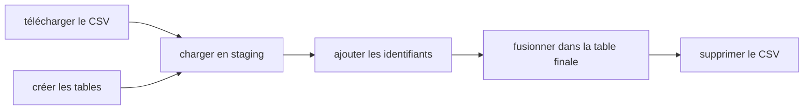
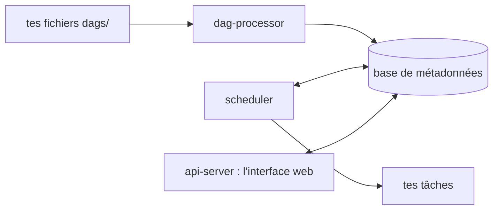

# Pourquoi un orchestrateur

Au module 1, tu lances ton pipeline à la main : `docker compose up`, tu attends, tu vérifies dans pgAdmin. Maintenant, imagine la vraie vie : un nouveau fichier de taxis arrive **chaque mois**, pour deux types de taxis, et ton entreprise veut les données chaque 1er du mois à 9 h.

Qui lance le pipeline ? Que se passe-t-il si le téléchargement échoue à 3 h du matin ? Comment savoir quels mois sont déjà chargés, et lesquels ont raté ? Et si on te demande de recharger toute l'année 2019 ?

Un **orchestrateur** répond à ces questions. Il lance tes tâches dans le bon ordre, au bon moment, les relance quand elles échouent, garde l'historique de chaque exécution et te montre tout dans une interface web. Il ne remplace pas ton code : il **pilote** ton code.

## Le vocabulaire d'Airflow

| Mot | Ce que c'est | Dans ton pipeline de taxis |
| --- | --- | --- |
| **DAG** | Un pipeline : des tâches reliées par des flèches, écrit dans un fichier Python | Le pipeline complet d'un mois de taxis |
| **Tâche** (task) | Une étape du DAG, qui fait une seule chose | Télécharger le fichier, le charger, fusionner |
| **Opérateur** | Un modèle de tâche prêt à l'emploi | `BashOperator` lance une commande, `@task` lance une fonction Python |
| **Run** (exécution) | Une exécution du DAG, à une date donnée | Le run de janvier 2019 |
| **Planification** (schedule) | Quand le DAG se lance tout seul | Le 1er de chaque mois à 9 h |
| **Backfill** | Lancer le DAG pour des dates passées | Recharger tous les mois de 2019 |
| **Connexion** | Les identifiants d'un service extérieur, gardés hors du code | L'adresse et le mot de passe de Postgres |

**DAG** veut dire *Directed Acyclic Graph* : un graphe **orienté** (les flèches vont dans un sens) et **acyclique** (aucune flèche ne revient en arrière, donc pas de boucle). C'est ce qui garantit qu'un pipeline a un début et une fin.

Ici, « télécharger » et « créer les tables » ne dépendent pas l'une de l'autre : Airflow peut les lancer **en même temps**.

## Les pièces d'Airflow 3

Airflow n'est pas un seul programme, mais plusieurs services qui travaillent ensemble. Tu les lanceras tous avec Docker Compose à la leçon suivante.

| Service | Son rôle |
| --- | --- |
| **api-server** | L'interface web (port 8080) et l'API |
| **scheduler** | Décide quelles tâches lancer, et quand. Avec le **LocalExecutor**, c'est lui qui exécute les tâches, dans son conteneur |
| **dag-processor** | Lit tes fichiers Python dans `dags/` et les transforme en DAGs |
| **triggerer** | Gère les tâches qui attendent longtemps un événement, sans bloquer le reste |
| **Base de métadonnées** | Un Postgres à Airflow : l'état de chaque run et de chaque tâche, l'historique |

## cron ou orchestrateur ?

`cron` est le planificateur de Linux : une ligne comme `0 9 1 * * python ingest.py` lance un script le 1er de chaque mois à 9 h. C'est simple, mais c'est tout.

| Besoin | cron | Airflow |
| --- | --- | --- |
| Lancer à heure fixe | Oui | Oui |
| Plusieurs étapes, dans un ordre précis | À toi de l'écrire dans le script | Les flèches du DAG |
| Relancer une étape qui a échoué | Non | Oui, réessais automatiques |
| Historique : quel mois a marché ou raté | Non | Oui, dans l'interface |
| Recharger 12 mois passés | À la main | Une commande de backfill |
| Voir les logs de chaque étape | Fichiers à chercher | Un clic sur la tâche |

## Airflow ou Kestra ?

Le cours officiel 2026 utilise **Kestra**, où les pipelines s'écrivent en YAML. Ce cours utilise **Airflow**, où ils s'écrivent en Python : c'est l'orchestrateur le plus demandé dans les offres d'emploi en data engineering, et ce que tu apprends ici (tâches, dépendances, planification, backfill, idempotence) s'applique à tous les orchestrateurs. Kestra t'attend en **bonus** à la fin du cours, avec le même pipeline des taxis : tu pourras comparer.

@@ predict
Ton script d'ingestion est lancé par cron le 1er de chaque mois à 9 h. Le 1er mars, le serveur qui héberge les fichiers est en panne pendant 10 minutes, juste à 9 h. Que se passe-t-il pour les données de mars avec cron ? Et avec un orchestrateur réglé pour réessayer 3 fois, à 5 minutes d'intervalle ?

@@ predict-answer
**Avec cron**, le script échoue une fois, et c'est tout : les données de mars ne sont jamais chargées, et personne n'est prévenu. Tu le découvres des semaines plus tard, quand un tableau de bord est vide.

**Avec l'orchestrateur**, la tâche échoue à 9 h, réessaie à 9 h 05, puis à 9 h 10, quand le serveur est revenu : elle réussit. Et si tous les essais avaient échoué, le run serait marqué en rouge dans l'interface, avec le log de l'erreur, et tu pourrais le relancer en un clic.

@@ practice
Avant d'écrire du code, dessine ton premier DAG **en texte**. Prends le pipeline que tu as construit au module 1 (télécharger des taxis et des zones, les charger dans Postgres) et découpe-le en tâches.

@@ constraints
- Au moins 4 tâches, chacune fait **une seule chose**, avec un nom clair en `snake_case`
- Les dépendances sont écrites avec des flèches, comme dans Airflow : `tache_a >> tache_b`
- Au moins deux tâches peuvent tourner **en parallèle**, et tu dis lesquelles
- Pour chaque tâche, une phrase : que se passe-t-il si on la lance **deux fois** de suite ?

@@ guide
### 1. Liste ce que fait ton pipeline

Relis ton script `ingest_data.py` du module 1, ou ton défi des aéroports. Écris chaque action sur une ligne, dans l'ordre : télécharger, créer la table, insérer… Chaque ligne deviendra peut-être une tâche.

### 2. Découpe en tâches

Une bonne tâche fait une seule chose, qu'on peut relancer seule si elle échoue. Exemple, sur un autre sujet, un pipeline météo :

~~~text
telecharger_meteo      : récupère le fichier météo du jour
telecharger_villes     : récupère la liste des villes
joindre                : associe chaque mesure à sa ville
publier                : écrit le résultat dans la base
~~~

### 3. Relie-les par des flèches

`a >> b` veut dire « b commence quand a a réussi ». Une liste entre crochets veut dire « toutes celles-là » :

~~~text
[telecharger_meteo, telecharger_villes] >> joindre >> publier
~~~

Ici, les deux téléchargements tournent en parallèle, et `joindre` attend les deux.

### 4. Pense à la relance

Pour chaque tâche, demande-toi : si je la relance, est-ce que j'obtiens **le même résultat**, ou est-ce que je crée des doublons ? Dans l'exemple, `publier` qui fait un simple `INSERT` deux fois mettrait chaque ligne en double. C'est le problème de l'**idempotence**, au cœur de ce module.

Écris ton DAG dans la case ci-dessous, puis compare avec la solution.

@@ hints
- Le module 1 télécharge deux fichiers : les trajets et les zones. Ils ne dépendent pas l'un de l'autre.
- `to_sql` avec `if_exists="replace"` recrée la table à chaque fois : relancer ne crée pas de doublons. Avec `"append"`, si.
- Une tâche qui « crée la table si elle n'existe pas » peut se relancer sans danger : c'est `CREATE TABLE IF NOT EXISTS`.

@@ solution
Une version possible, pour les taxis verts de janvier 2021 :

~~~text
telecharger_trajets  : télécharge le CSV des trajets
telecharger_zones    : télécharge le CSV des zones
creer_tables         : CREATE TABLE IF NOT EXISTS pour les deux tables
charger_zones        : remplace le contenu de la table zones
charger_trajets      : charge les trajets du mois
verifier             : compte les lignes et échoue si la table est vide

[telecharger_zones, creer_tables] >> charger_zones
[telecharger_trajets, creer_tables] >> charger_trajets
[charger_zones, charger_trajets] >> verifier
~~~

**En parallèle** : les deux téléchargements et la création des tables, puis les deux chargements.

**Relancer deux fois** :

- les téléchargements écrasent le même fichier : même résultat ;
- `creer_tables` avec `IF NOT EXISTS` ne fait rien la deuxième fois ;
- `charger_zones` remplace tout : même résultat ;
- `charger_trajets` : **danger**. Avec un simple ajout, les trajets seraient en double. Il faut soit vider les lignes du mois avant de les recharger, soit n'ajouter que les lignes absentes. C'est exactement ce que tu construiras à la leçon 7 ;
- `verifier` ne modifie rien : sans danger.

@@ selfcheck
- Chaque tâche de mon DAG fait une seule chose
- J'ai repéré au moins une tâche qui crée des doublons si on la relance

@@ explain
Explique à un ami qui connaît `cron` ce qu'un orchestrateur comme Airflow fait en plus. Puis explique pourquoi un DAG ne doit jamais avoir de boucle.

@@ resources
- [Les concepts de base d'Airflow (documentation officielle)](https://airflow.apache.org/docs/apache-airflow/stable/core-concepts/overview.html)
- [L'architecture d'Airflow 3](https://airflow.apache.org/docs/apache-airflow/stable/core-concepts/overview.html#architecture-diagrams)
- [Le cours gratuit Airflow 101 d'Astronomer](https://academy.astronomer.io/)
- [Le module officiel du Zoomcamp, avec Kestra](https://github.com/DataTalksClub/data-engineering-zoomcamp/tree/main/02-workflow-orchestration)

@@ declic
- [01-09] Au module 1, `depends_on` disait à Compose « lance l'ingestion seulement quand Postgres est prêt ». C'était déjà une dépendance entre tâches : un orchestrateur généralise cette idée à tout ton pipeline, et la répète chaque mois.

@@ teaser
- [02-07] Le DAG que tu viens de dessiner, tu vas l'écrire pour de vrai, et le rendre impossible à mettre en double.
- [02-08] Recharger toute une année d'un coup, en une commande : le backfill.
