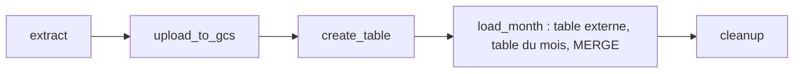

# Le même pipeline vers Google Cloud

En entreprise, les données des taxis n'iraient pas dans un Postgres de ton Codespace, mais dans le cloud : les fichiers bruts dans un **bucket Cloud Storage** (le *data lake*), et les tables dans **BigQuery** (l'entrepôt de données). Tu as créé les deux avec Terraform au module 1. Ton DAG va maintenant les remplir.



Le principe est **le même** qu'avec Postgres, staging et fusion compris. Seuls les outils changent :

| Étape | Postgres (leçon 7) | Google Cloud (ici) |
| --- | --- | --- |
| Le fichier brut | reste dans `data/` | copié dans le bucket |
| La staging | `green_tripdata_staging`, remplie par `COPY` | une **table externe** qui lit le CSV dans le bucket, puis une table du mois |
| L'identifiant | `md5(...)` | `MD5(CONCAT(...))` |
| La fusion | `MERGE` | `MERGE`, presque mot pour mot |

## La clé : montée en lecture seule

Au module 1, ta clé de compte de service est dans `~/.gcp/key.json`, hors du repo, écrite depuis le secret Codespaces `GCP_SA_KEY`. Les conteneurs d'Airflow ne voient pas ton dossier personnel : il faut **monter** ce fichier dans les conteneurs, comme le dossier `dags/` :

```yaml
    - ${HOME}/.gcp/key.json:/opt/airflow/gcp/key.json:ro
```

`${HOME}` est ton dossier personnel (`/home/codespace`). `:ro` (*read-only*) : Airflow peut lire la clé, jamais la modifier. La clé reste hors de Git et hors de l'image.

## La connexion Google Cloud

Les opérateurs et hooks Google utilisent la connexion `google_cloud_default`. Elle ne contient pas de mot de passe, mais le **chemin de la clé** et l'**ID du projet**. Une adresse comme pour Postgres serait illisible : on l'écrit en JSON, toujours dans `.env` :

```text
AIRFLOW_CONN_GOOGLE_CLOUD_DEFAULT='{"conn_type": "google_cloud_platform", "extra": {"key_path": "/opt/airflow/gcp/key.json", "project": "dez-zoomcamp-123456"}}'
```

Les guillemets simples autour protègent les guillemets doubles du JSON.

## Les variables Airflow

Le nom du bucket, du dataset, du projet et l'emplacement ne sont pas des secrets, mais ils changent d'un compte à l'autre. Airflow a des **variables** pour ça : des réglages nommés, lus par les DAGs. Comme les connexions, elles peuvent venir de `.env`, avec le préfixe `AIRFLOW_VAR_` :

```text
AIRFLOW_VAR_GCP_BUCKET=dez-zoomcamp-123456-dez-lake
```

Dans un DAG, deux façons de les lire :

| Où | Comment |
| --- | --- |
| Dans une tâche Python | `Variable.get("gcp_bucket")`, avec `from airflow.sdk import Variable` |
| Dans un champ templaté | `"{{ var.value.gcp_bucket }}"` |

Le nom s'écrit en minuscules dans le DAG, et en majuscules après `AIRFLOW_VAR_` dans `.env`. Lis-les **dans** les tâches, jamais tout en haut du fichier : le dag-processor relit tes fichiers très souvent, et chaque lecture coûterait une requête (leçon 10).

## Les outils Google

- `LocalFilesystemToGCSOperator(src=..., dst=..., bucket=...)` copie un fichier local dans un bucket.
- `BigQueryHook().insert_job(configuration=..., location=...)` lance une requête SQL dans BigQuery et attend qu'elle finisse.

Une **table externe** BigQuery ne contient pas de données : elle **lit le CSV dans le bucket** à chaque requête. C'est la staging idéale, sans rien charger. On en tire ensuite une vraie table du mois avec l'identifiant, puis on fusionne. Les colonnes viennent de ton module `taxi_schema.py`, avec une petite table de correspondance entre types Postgres et types BigQuery.

## Ce qui a été testé

Tout ce module a été exécuté sur un vrai Airflow 3.3.2, **sauf l'aller-retour avec Google Cloud** : faute de compte de test, le DAG de cette leçon a été vérifié jusqu'à la connexion à Google (clé lue, projet reconnu, tâche `extract` verte), et ses requêtes BigQuery ont été validées par un analyseur SQL. Si BigQuery refuse une requête chez toi, son message d'erreur dit précisément quelle ligne et quelle colonne poser problème : lis-le en entier.

@@ codespaces
- Ta clé `~/.gcp/key.json` est dans ton dossier personnel : elle survit à un arrêt du Codespace, mais **pas** à une reconstruction (*rebuild*) ni à un nouveau Codespace. Dans ces cas, réécris-la depuis le secret : `mkdir -p ~/.gcp && echo "$GCP_SA_KEY" > ~/.gcp/key.json`.
- BigQuery facture les requêtes au volume lu, avec 1 To gratuit par mois. Un mois de taxis verts pèse environ 50 Mo : tu peux lancer ce DAG des centaines de fois sans rien payer.

@@ predict
Tu lances `docker compose up -d` alors que le fichier `~/.gcp/key.json` **n'existe pas** (tu as reconstruit ton Codespace et oublié de réécrire la clé). Compose refuse-t-il de démarrer ? Que trouve-t-on ensuite à la place de la clé ?

@@ predict-answer
**Compose démarre sans broncher.** Quand le fichier à monter n'existe pas, Docker crée à sa place… un **dossier vide**, nommé `key.json`, qui appartient à `root`. Airflow démarre, et c'est seulement au premier appel à Google qu'une tâche échoue avec `IsADirectoryError: [Errno 21] Is a directory: '/opt/airflow/gcp/key.json'`. Et `ls -la ~/.gcp` montre un dossier `key.json`. Tu vas le réparer dans l'exercice « casser et réparer ».

@@ practice
Écris le DAG `taxi_gcp` : le même pipeline que `taxi_postgres`, mais vers ton bucket et ton dataset BigQuery du module 1.

@@ constraints
- Ta clé est montée en lecture seule dans les conteneurs, et la connexion `google_cloud_default` et quatre variables (`gcp_project_id`, `gcp_bucket`, `gcp_dataset`, `gcp_location`) sont dans `.env`. Aucun ID de projet, nom de bucket ni chemin de clé dans le fichier du DAG
- Les trois mêmes paramètres qu'à la leçon 7, et cinq tâches : `extract`, `upload_to_gcs`, `create_table`, `load_month`, `cleanup`
- La table finale `green_tripdata` est **partitionnée** par jour de prise en charge
- Lancé deux fois pour `green`, 2019, `01`, la table finale contient 630 918 trajets les deux fois
- Tu supprimes ce que tu as créé quand tu as fini (le module 1 t'a appris `terraform destroy`)

@@ guide
### 1. Vérifie ton infrastructure du module 1

Dans la console Google Cloud, ton bucket `<project-id>-dez-lake` et ton dataset `dez_dataset` doivent exister, au **même emplacement** (`EU` ou `US`). Sinon, recrée-les avec ton Terraform de la leçon 1-13 : `terraform apply`.

### 2. La clé, dans ton Codespace puis dans les conteneurs

~~~bash
ls -la ~/.gcp/key.json
head -c 40 ~/.gcp/key.json
~~~

Le fichier doit exister et commencer par `{ "type": "service_account"`. Puis, dans `docker-compose.yaml`, ajoute la ligne de montage de la leçon à la liste `volumes:` de `x-airflow-common`.

### 3. La connexion et les variables dans .env

Ajoute à `.env` la connexion de la leçon, avec **ton** ID de projet, puis quatre lignes `AIRFLOW_VAR_...` : l'ID du projet, le nom du bucket, le nom du dataset, l'emplacement. Applique et vérifie :

~~~bash
docker compose up -d
docker compose exec airflow-scheduler airflow connections get google_cloud_default
docker compose exec airflow-scheduler airflow variables get gcp_bucket
~~~

### 4. Teste la connexion avant d'écrire le DAG

Un petit test en Python, dans le conteneur, qui lit ta clé avec le hook :

~~~bash
docker compose exec airflow-scheduler python -c "
from airflow.providers.google.cloud.hooks.gcs import GCSHook
from airflow.sdk import Variable
print(GCSHook().list(Variable.get('gcp_bucket')))"
~~~

Le texte entre guillemets doubles est un petit programme Python sur plusieurs lignes : `python -c` l'exécute dans le conteneur.

Une liste (peut-être vide `[]`) : la clé, la connexion et les droits sont bons. Une erreur : lis-la avant d'aller plus loin. Ce n'est pas la peine de déboguer un DAG si la connexion ne marche pas.

### 5. Le DAG, en partant de taxi_postgres

`cp dags/taxi_postgres.py dags/taxi_gcp.py`. Garde `extract`, `cleanup`, les paramètres et les constantes. Remplace les tâches Postgres par :

- `upload_to_gcs` : un `LocalFilesystemToGCSOperator`, avec le bucket en template de variable ;
- `create_table` : une tâche `@task` qui crée la table finale si elle n'existe pas, avec les colonnes de `COLUMNS[taxi]` en types BigQuery, et `PARTITION BY DATE(<colonne de prise en charge>)` ;
- `load_month` : une tâche `@task` qui lance trois requêtes, la table externe, la table du mois, le `MERGE`.

Une petite fonction `run_query(sql)`, hors du DAG, évite de répéter l'appel au hook dans chaque tâche.

### 6. Les types BigQuery

Un dictionnaire de correspondance suffit : `text` devient `STRING`, `timestamp` reste `TIMESTAMP`, `integer` devient `INT64`, `double precision` devient `NUMERIC`. L'identifiant, en BigQuery, est de type `BYTES` : c'est ce que renvoie `MD5`.

### 7. Les noms complets

Dans BigQuery, une table se nomme `projet.dataset.table`, entre accents graves : `` `dez-zoomcamp-123456.dez_dataset.green_tripdata` ``. Les accents graves sont obligatoires dès que le nom contient un tiret, ce qui est le cas de la plupart des ID de projets.

### 8. Lance deux fois, puis vérifie dans BigQuery

`airflow dags test taxi_gcp`, deux fois. Puis, dans la console BigQuery :

~~~sql
SELECT filename, COUNT(*) FROM `dez-zoomcamp-123456.dez_dataset.green_tripdata` GROUP BY 1;
~~~

### 9. Range derrière toi

Les tables du mois (`green_tripdata_2019_01` et `_ext`) restent dans le dataset : supprime-les dans la console si tu veux. Et quand tu as fini le module, `terraform destroy` dans ton dossier Terraform supprime le bucket et le dataset (vide le bucket d'abord, ou ajoute `force_destroy = true` au bucket).

@@ hints
- `IsADirectoryError` sur `key.json` : la clé n'existait pas au démarrage des conteneurs. Regarde l'exercice « casser et réparer ».
- `403` avec `Permission denied` ou `Access Denied` : ton compte de service n'a pas le rôle nécessaire. Il lui faut Storage Admin et BigQuery Admin (leçon 1-13).
- `Not found: Dataset` ou `location` dans l'erreur : ton dataset n'est pas à l'emplacement donné par `gcp_location`, ou le bucket et le dataset ne sont pas au même emplacement.

@@ solution
Dans `docker-compose.yaml`, la liste des volumes de `x-airflow-common` gagne une ligne :

~~~yaml
    - ${HOME}/.gcp/key.json:/opt/airflow/gcp/key.json:ro   # la clé, en lecture seule
~~~

Dans `.env` (jamais commité), avec tes valeurs à la place des exemples :

~~~text
AIRFLOW_CONN_GOOGLE_CLOUD_DEFAULT='{"conn_type": "google_cloud_platform", "extra": {"key_path": "/opt/airflow/gcp/key.json", "project": "dez-zoomcamp-123456"}}'
AIRFLOW_VAR_GCP_PROJECT_ID=dez-zoomcamp-123456
AIRFLOW_VAR_GCP_BUCKET=dez-zoomcamp-123456-dez-lake
AIRFLOW_VAR_GCP_DATASET=dez_dataset
AIRFLOW_VAR_GCP_LOCATION=EU
~~~

`dags/taxi_gcp.py` :

~~~python
from datetime import datetime

from airflow.providers.google.cloud.hooks.bigquery import BigQueryHook
from airflow.providers.google.cloud.transfers.local_to_gcs import LocalFilesystemToGCSOperator
from airflow.providers.standard.operators.bash import BashOperator
from airflow.sdk import Param, Variable, dag, task

from taxi_schema import COLUMNS

DATA = "/opt/airflow/data"
TAXI = "{{ params.taxi }}"
FICHIER = "{{ params.taxi }}_tripdata_{{ params.year }}-{{ params.month }}.csv"
URL = "https://github.com/DataTalksClub/nyc-tlc-data/releases/download/{{ params.taxi }}/" + FICHIER + ".gz"
# Le type BigQuery qui correspond à chaque type Postgres de taxi_schema.py
BQ_TYPES = {"text": "STRING", "timestamp": "TIMESTAMP", "integer": "INT64", "double precision": "NUMERIC"}


def run_query(sql: str):
    """Lance une requête BigQuery et attend qu'elle finisse."""
    print(sql)
    BigQueryHook().insert_job(
        configuration={"query": {"query": sql, "useLegacySql": False}},
        location=Variable.get("gcp_location"),
    )


@dag(
    dag_id="taxi_gcp",
    start_date=datetime(2026, 1, 1),
    schedule=None,
    catchup=False,
    params={
        "taxi": Param("green", enum=["yellow", "green"]),
        "year": Param("2019", enum=["2019", "2020", "2021"]),
        "month": Param("01", enum=[f"{m:02d}" for m in range(1, 13)]),
    },
    tags=["module-02"],
)
def taxi_gcp():
    extract = BashOperator(
        task_id="extract",
        bash_command="set -o pipefail; curl -sSLf " + URL + " | gunzip > " + DATA + "/" + FICHIER + " && ls -lh " + DATA + "/" + FICHIER,
    )

    # Copie le fichier dans le bucket, sous le même nom
    upload = LocalFilesystemToGCSOperator(
        task_id="upload_to_gcs",
        src=DATA + "/" + FICHIER,
        dst=FICHIER,
        bucket="{{ var.value.gcp_bucket }}",
    )

    @task
    def create_table(taxi: str):
        project, dataset = Variable.get("gcp_project_id"), Variable.get("gcp_dataset")
        cols = ", ".join(f"{name} {BQ_TYPES[kind]}" for name, kind in COLUMNS[taxi].items())
        pickup = "tpep_pickup_datetime" if taxi == "yellow" else "lpep_pickup_datetime"
        # Partitionnée par jour : une requête sur un mois ne lit que ce mois
        run_query(f"""
            CREATE TABLE IF NOT EXISTS `{project}.{dataset}.{taxi}_tripdata`
            (unique_row_id BYTES, filename STRING, {cols})
            PARTITION BY DATE({pickup});
        """)

    @task
    def load_month(taxi: str, file: str):
        project, dataset, bucket = Variable.get("gcp_project_id"), Variable.get("gcp_dataset"), Variable.get("gcp_bucket")
        cols = ", ".join(f"{name} {BQ_TYPES[kind]}" for name, kind in COLUMNS[taxi].items())
        p = "tpep" if taxi == "yellow" else "lpep"
        month = file.removesuffix(".csv").replace("-", "_")  # green_tripdata_2019_01
        ext, tmp = f"`{project}.{dataset}.{month}_ext`", f"`{project}.{dataset}.{month}`"
        # 1. Une table externe : BigQuery lit le CSV directement dans le bucket
        run_query(f"""
            CREATE OR REPLACE EXTERNAL TABLE {ext} ({cols})
            OPTIONS (format = 'CSV', uris = ['gs://{bucket}/{file}'], skip_leading_rows = 1, ignore_unknown_values = TRUE);
        """)
        # 2. Une vraie table pour ce mois, avec l'identifiant unique et le nom du fichier
        run_query(f"""
            CREATE OR REPLACE TABLE {tmp} AS
            SELECT
              MD5(CONCAT(COALESCE(VendorID, ''), COALESCE(CAST({p}_pickup_datetime AS STRING), ''),
                         COALESCE(CAST({p}_dropoff_datetime AS STRING), ''), COALESCE(PULocationID, ''),
                         COALESCE(DOLocationID, ''), COALESCE(CAST(fare_amount AS STRING), ''),
                         COALESCE(CAST(trip_distance AS STRING), ''))) AS unique_row_id,
              '{file}' AS filename,
              *
            FROM {ext};
        """)
        # 3. On ajoute à la table finale seulement les trajets qu'elle n'a pas encore
        names = ["unique_row_id", "filename", *COLUMNS[taxi]]
        run_query(f"""
            MERGE INTO `{project}.{dataset}.{taxi}_tripdata` T
            USING {tmp} S
            ON T.unique_row_id = S.unique_row_id
            WHEN NOT MATCHED THEN
              INSERT ({", ".join(names)}) VALUES ({", ".join("S." + n for n in names)});
        """)

    cleanup = BashOperator(task_id="cleanup", bash_command="rm -f " + DATA + "/" + FICHIER)

    extract >> upload >> create_table(TAXI) >> load_month(TAXI, FICHIER) >> cleanup


taxi_gcp()
~~~

@@ selfcheck
- `grep -nE "dez-zoomcamp|key.json|dez_dataset" dags/taxi_gcp.py` ne trouve rien
- Deux runs de suite donnent 630 918 trajets dans `green_tripdata`
- Dans la console, l'onglet Détails de `green_tripdata` indique qu'elle est partitionnée par jour

@@ breakfix
Simule un Codespace reconstruit : `docker compose down`, puis renomme ta clé avec `mv ~/.gcp/key.json ~/.gcp/key.json.bak`, puis `docker compose up -d`. Lance `taxi_gcp`. Regarde l'erreur, puis ce qu'il y a dans `~/.gcp/`. Répare.

@@ breakfix-hints
- `extract` réussit, `upload_to_gcs` échoue. Cherche `Error` dans son log.
- `ls -la ~/.gcp/` : `key.json` est maintenant un **dossier**, qui appartient à `root`.
- Un dossier de `root` se supprime avec `sudo`. Et les conteneurs doivent être arrêtés pendant la réparation, puis redémarrés.

@@ breakfix-answer
`upload_to_gcs` échoue avec :

~~~text
IsADirectoryError: [Errno 21] Is a directory: '/opt/airflow/gcp/key.json'
~~~

Au démarrage, Docker n'a pas trouvé `~/.gcp/key.json` : il a créé un **dossier vide** à sa place pour pouvoir le monter, en tant que `root`. Pour réparer :

~~~bash
docker compose down
sudo rm -r ~/.gcp/key.json
mv ~/.gcp/key.json.bak ~/.gcp/key.json    # après un vrai rebuild : echo "$GCP_SA_KEY" > ~/.gcp/key.json
docker compose up -d
~~~

Retiens l'ordre : **d'abord la clé, ensuite les conteneurs**. Après chaque reconstruction de Codespace, réécris la clé avant `docker compose up`.

@@ explain
Explique le chemin de ta clé de compte de service, depuis le fichier téléchargé sur ton PC jusqu'au hook qui l'utilise dans une tâche. À chaque étape, dis pourquoi elle ne finit jamais dans Git.

@@ resources
- [La connexion Google Cloud dans Airflow](https://airflow.apache.org/docs/apache-airflow-providers-google/stable/connections/gcp.html)
- [Les variables Airflow](https://airflow.apache.org/docs/apache-airflow/stable/core-concepts/variables.html)
- [Les tables externes BigQuery](https://cloud.google.com/bigquery/docs/external-data-cloud-storage)
- [Le flow Kestra officiel dont ce DAG est la traduction](https://github.com/DataTalksClub/data-engineering-zoomcamp/blob/main/02-workflow-orchestration/flows/08_gcp_taxi.yaml)

@@ declic
- [01-13] Le secret `GCP_SA_KEY` et le fichier `~/.gcp/key.json` hors du repo, c'était pour ce moment : ton orchestrateur utilise la même clé que Terraform, sans qu'elle soit jamais copiée dans ton code.
- [01-12] Le bucket et le dataset que Terraform a créés, puis détruits en une commande : les voilà remplis par un pipeline. Infrastructure en code d'un côté, pipeline en code de l'autre.

@@ teaser
- [03-02] Ton `PARTITION BY DATE(...)` : au module 3, tu mesures combien de données il évite de lire.
- [P] Dans ton projet final, ce DAG sera ta brique d'ingestion : planifié, vers ton data lake, puis transformé par dbt.
